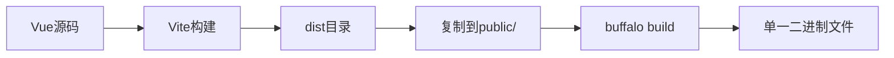

## 产品概述

Catter CMS管理后台优化项目，目标是构建一个**现代化、功能完整、单二进制部署**的内容管理系统管理后台。

## 核心功能

### 已有功能（需优化）

- 用户登录/登出（JWT认证）
- 基础仪表盘
- 文章列表与编辑
- 分类管理API

### 新增功能

1. **用户管理模块**：用户列表、创建/编辑用户、角色分配、状态管理
2. **角色权限系统**：角色定义、权限配置、访问控制
3. **标签管理**：标签CRUD、标签关联
4. **媒体库管理**：文件上传、图片预览、媒体管理
5. **主题配置**：主题切换、主题配置管理
6. **系统设置**：站点信息、SEO设置、邮件配置

### UI/UX要求

- 现代化设计风格（类似Vercel/Notion）
- 响应式布局（适配桌面和平板）
- 流畅的交互动效
- 深色/浅色主题支持
- 统一的设计语言和组件规范

## 技术约束

- 单端部署：Vue SPA构建后嵌入Buffalo的public目录
- 不修改Buffalo框架本身
- 前台SSR和静态生成保持不变

## 技术栈

### 后端

- **框架**：Go 1.25 + Buffalo 1.1.3
- **数据库**：SQLite（开发）/ PostgreSQL（生产可选）
- **认证**：JWT (golang-jwt/jwt)
- **API**：RESTful设计

### 前端

- **框架**：Vue 3.4 + TypeScript
- **构建工具**：Vite 5
- **UI组件库**：Element Plus 2.4
- **状态管理**：Pinia 2.1
- **路由**：Vue Router 4.2
- **HTTP客户端**：Axios
- **工具库**：VueUse

## 实现方案

### 架构设计

```
┌─────────────────────────────────────────────────────────────┐
│                    Buffalo 服务（单二进制）                    │
├─────────────────────────────────────────────────────────────┤
│  ┌─────────────┐  ┌─────────────┐  ┌─────────────────────┐  │
│  │  前台SSR    │  │  静态生成   │  │    管理后台SPA      │  │
│  │  (Plush)    │  │  (命令)     │  │  (Vue 3嵌入)        │  │
│  └─────────────┘  └─────────────┘  └─────────────────────┘  │
├─────────────────────────────────────────────────────────────┤
│                      API层 (RESTful)                         │
│  /api/auth/*  /api/posts/*  /api/categories/*  /api/admin/* │
├─────────────────────────────────────────────────────────────┤
│                     业务逻辑层 (Services)                     │
├─────────────────────────────────────────────────────────────┤
│                     数据访问层                        │
├─────────────────────────────────────────────────────────────┤
│                     数据模型层                        │
└─────────────────────────────────────────────────────────────┘
```

### 部署流程



### 目录结构

```
catter-cms/
├── actions/                    # Buffalo控制器
│   ├── admin/                  # 管理后台API [MODIFY]
│   │   ├── dashboard.go        # [MODIFY] 仪表盘API
│   │   ├── users.go            # [MODIFY] 用户管理API
│   │   ├── media.go            # [MODIFY] 媒体管理API
│   │   ├── settings.go         # [MODIFY] 系统设置API
│   │   └── roles.go            # [NEW] 角色管理API
│   ├── api/                    # 前台API
│   │   ├── auth.go             # [KEEP] 认证API
│   │   ├── posts.go            # [KEEP] 文章API
│   │   └── categories.go       # [KEEP] 分类API
│   └── app.go                  # [MODIFY] 路由配置
├── admin/                      # Vue前端项目 [MODIFY]
│   ├── src/
│   │   ├── components/         # [NEW/EXPAND] 通用组件
│   │   │   ├── layout/         # 布局组件
│   │   │   │   ├── AppLayout.vue
│   │   │   │   ├── Sidebar.vue
│   │   │   │   └── Header.vue
│   │   │   ├── common/         # 通用组件
│   │   │   │   ├── PageHeader.vue
│   │   │   │   ├── SearchBar.vue
│   │   │   │   ├── DataTable.vue
│   │   │   │   └── ConfirmDialog.vue
│   │   │   └── form/           # 表单组件
│   │   │       ├── RichEditor.vue
│   │   │       └── ImageUpload.vue
│   │   ├── views/              # [EXPAND] 页面组件
│   │   │   ├── Login.vue       # [MODIFY] 登录页优化
│   │   │   ├── Dashboard.vue   # [MODIFY] 仪表盘完善
│   │   │   ├── posts/          # [NEW] 文章模块
│   │   │   │   ├── PostList.vue
│   │   │   │   └── PostEdit.vue
│   │   │   ├── categories/     # [NEW] 分类模块
│   │   │   │   └── CategoryList.vue
│   │   │   ├── tags/           # [NEW] 标签模块
│   │   │   │   └── TagList.vue
│   │   │   ├── users/          # [NEW] 用户模块
│   │   │   │   ├── UserList.vue
│   │   │   │   └── UserEdit.vue
│   │   │   ├── roles/          # [NEW] 角色模块
│   │   │   │   └── RoleList.vue
│   │   │   ├── media/          # [NEW] 媒体库
│   │   │   │   └── MediaLibrary.vue
│   │   │   ├── themes/         # [NEW] 主题管理
│   │   │   │   └── ThemeSettings.vue
│   │   │   └── settings/       # [NEW] 系统设置
│   │   │       ├── SiteSettings.vue
│   │   │       ├── SEOSettings.vue
│   │   │       └── EmailSettings.vue
│   │   ├── store/              # [EXPAND] 状态管理
│   │   │   ├── index.js        # [KEEP]
│   │   │   ├── user.js         # [NEW]
│   │   │   ├── post.js         # [NEW]
│   │   │   ├── category.js     # [NEW]
│   │   │   ├── tag.js          # [NEW]
│   │   │   ├── media.js        # [NEW]
│   │   │   └── settings.js     # [NEW]
│   │   ├── router/             # [MODIFY] 路由配置
│   │   │   └── index.js
│   │   ├── utils/              # [NEW] 工具函数
│   │   │   ├── request.js      # HTTP请求封装
│   │   │   ├── auth.js         # 认证工具
│   │   │   └── permission.js   # 权限工具
│   │   ├── styles/             # [NEW] 样式文件
│   │   │   ├── variables.scss  # CSS变量
│   │   │   ├── theme.scss      # 主题样式
│   │   │   └── global.scss     # 全局样式
│   │   ├── App.vue             # [MODIFY] 根组件
│   │   └── main.js             # [KEEP]
│   ├── vite.config.js          # [MODIFY] 构建配置
│   └── package.json            # [MODIFY] 依赖更新
├── models/                     # 数据模型
│   ├── user.go                 # [MODIFY] 添加角色字段
│   ├── role.go                 # [NEW] 角色模型
│   ├── permission.go           # [NEW] 权限模型
│   └── ...                     # 其他模型保持不变
├── middleware/                 # 中间件
│   └── auth.go                 # [KEEP] 认证中间件
└── public/                     # 静态文件（构建产物）
    └── index.html              # Vue构建输出
```

## 实现要点

### 1. 前端现代化设计

- 采用浅色主题为主，深色主题可选
- 侧边栏可折叠，响应式适配
- 卡片式布局，充足的留白
- 微动效增强交互体验

### 2. 构建流程优化

```
# 开发环境
cd admin && npm run dev  # Vite开发服务器

# 生产构建
cd admin && npm run build  # 输出到 dist/
cp -r admin/dist/* public/  # 复制到Buffalo静态目录
buffalo build --production  # 构建单一二进制
```

### 3. API规范

- 统一响应格式：`{ code, message, data }`
- 分页参数：`page`, `page_size`
- 认证头：`Authorization: Bearer <token>`

### 4. 性能优化

- Vite构建优化（代码分割、Tree Shaking）
- Element Plus按需加载
- 图片懒加载和压缩
- API响应缓存

## 设计风格

采用**现代极简风格**，融合Vercel和Notion的设计语言，打造专业、清爽、高效的管理后台界面。

### 设计原则

1. **留白优先**：充足的间距，内容呼吸感
2. **层次分明**：通过阴影和背景色区分层级
3. **交互反馈**：即时响应的状态变化
4. **功能导向**：减少装饰，聚焦任务

### 布局结构

```
┌──────────────────────────────────────────────────────────┐
│  Sidebar (240px/64px折叠)  │      Main Content          │
│  ┌──────────────────────┐  │  ┌──────────────────────┐  │
│  │ Logo                 │  │  │ Header (用户信息)     │  │
│  ├──────────────────────┤  │  ├──────────────────────┤  │
│  │ Menu Items           │  │  │                      │  │
│  │ - 仪表盘             │  │  │                      │  │
│  │ - 文章管理           │  │  │     Page Content     │  │
│  │ - 用户管理           │  │  │                      │  │
│  │ - 媒体库             │  │  │                      │  │
│  │ - 系统设置           │  │  │                      │  │
│  └──────────────────────┘  │  └──────────────────────┘  │
└──────────────────────────────────────────────────────────┘
```

### 页面规划

1. **登录页** - 居中卡片式登录框，品牌展示
2. **仪表盘** - 数据统计卡片 + 最近文章 + 快捷操作
3. **文章管理** - 搜索过滤 + 数据表格 + 批量操作
4. **文章编辑** - Markdown编辑器 + 侧边栏设置
5. **用户管理** - 用户表格 + 角色筛选
6. **媒体库** - 网格视图 + 上传区域
7. **系统设置** - Tab分组表单

### 组件规范

- **按钮**：主按钮（实心）、次按钮（边框）、文字按钮
- **表单**：统一标签宽度、验证提示位置一致
- **表格**：斑马纹、悬停高亮、操作列固定右侧
- **弹窗**：居中、遮罩、动画过渡
- **卡片**：圆角8px、浅阴影、悬停提升

## Agent Extensions

### SubAgent

- **code-explorer**: 用于在开发过程中探索代码库，查找现有实现模式、依赖关系和代码结构，确保新代码与项目风格一致。