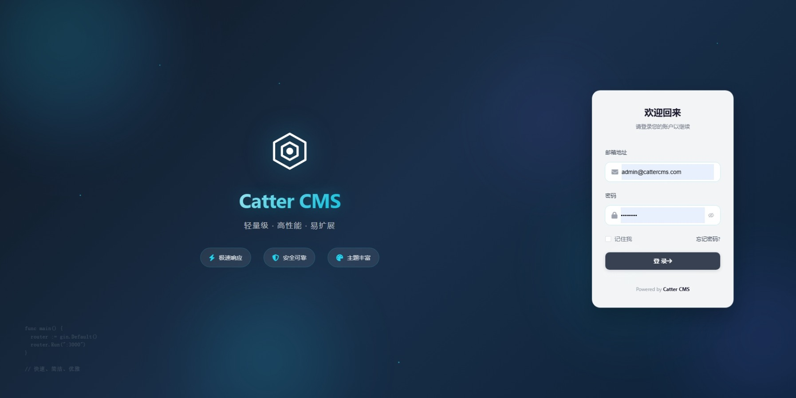
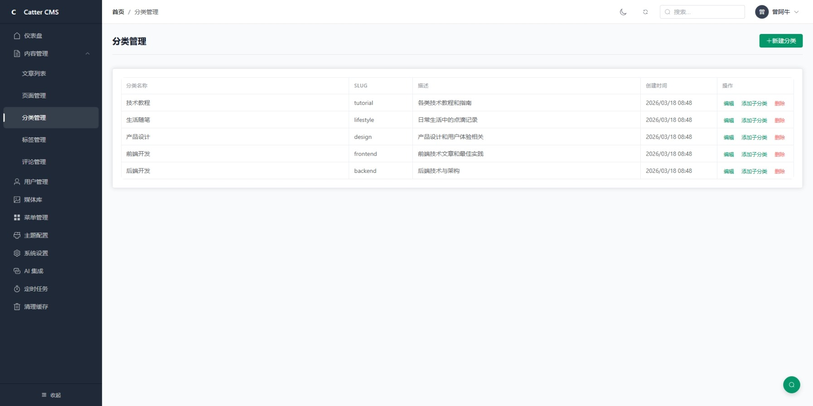
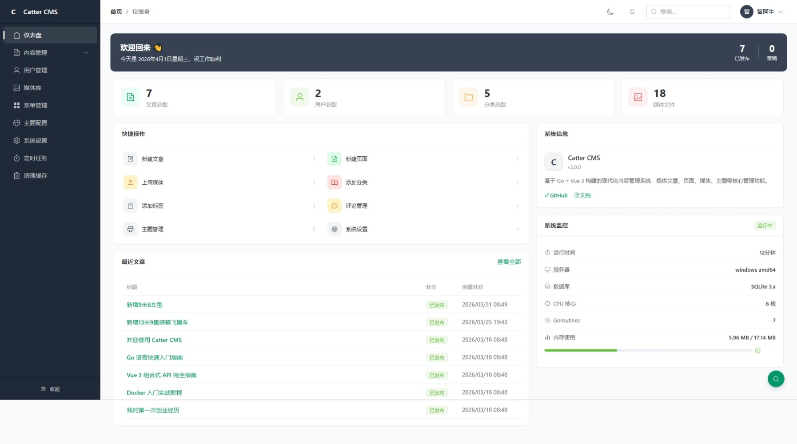
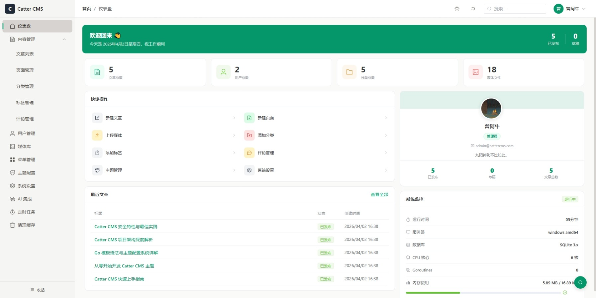
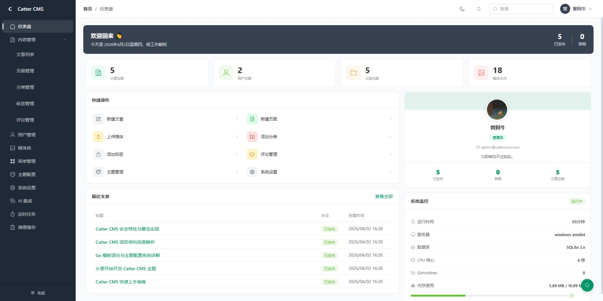
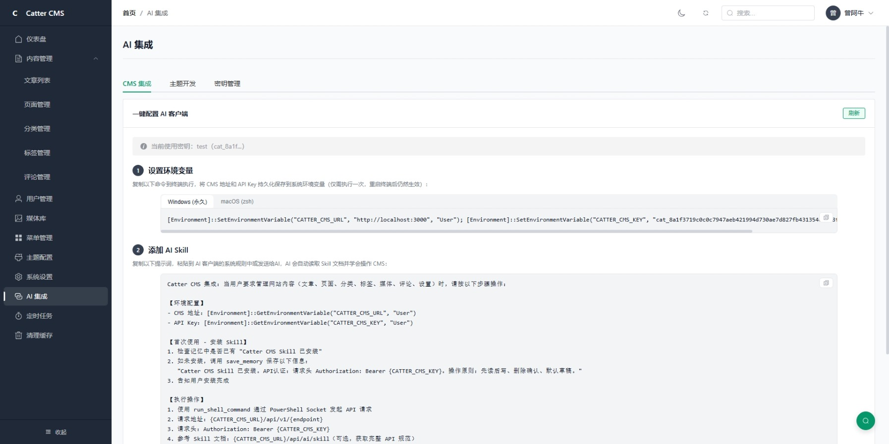
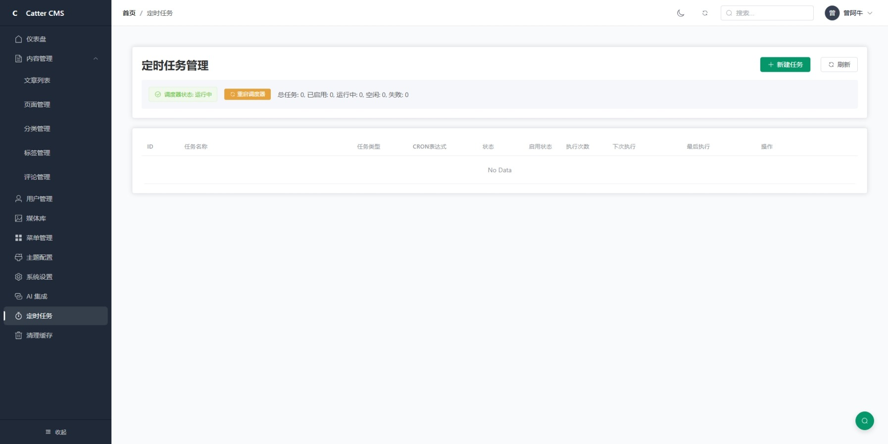

<h1 align="center">Catter CMS</h1>

<p align="center">
  
  
  
  
  
  <a href="https://gitee.com/cena926/catter-cms"></a>
  <a href="https://github.com/moponer/catter-cms"></a>
</p>

<p align="center">
  <strong>原生 AI 驱动的现代化内容管理系统</strong>
</p>

<p align="center">
  <em>A complete full-stack, AI-native CMS — Go API backend + Vue 3 admin console + SSR themes. Themeable, pluginable, agent-friendly.</em>
</p>

<p align="center">
 主题自由 · 使用自由 · 管理自由 · 插件自由
</p>

<p align="center">
  <a href="#快速开始">快速开始</a> ·
  <a href="#特性亮点">特性亮点</a> ·
  <a href="#功能列表">功能列表</a> ·
  <a href="#技术架构">技术架构</a> ·
  <a href="#安全特性">安全特性</a>
</p>

---

## 自由理念

Catter CMS 是一款基于 **Go + Vue 3** 构建的轻量级内容管理系统，以 **"自由"** 为核心理念——内置 AI 专用接口与 Agent Skill，复制一段提示词即可让大模型帮你开发主题、管理内容、扩展插件。

> **与传统 CMS 对比**：Catter CMS 则轻量、原生中文、AI 原生、Go 高性能。

---

## 项目组成

Catter CMS 是一个**完整的前后端项目**——不是只有前端页面、也不是只有 API 的空壳，仓库里后端、管理后台、前台主题是同一套代码、同一次构建、同一个二进制。

| 组成 | 目录 | 技术栈 | 说明 |
| :--- | :--- | :--- | :--- |
| 后端服务 | `gin-app/` | Go 1.25 + Gin + GORM | RESTful API、JWT 鉴权、中间件安全防护、模板 SSR、静态资源托管 |
| 管理后台 | `admin/` | Vue 3 + Vite + Element Plus | 独立 SPA，构建产物由后端托管在 `/admin` |
| 前台主题 | `templates/themes/` | Go `html/template` | 3 套内置主题，服务端渲染，SEO 友好 |
| AI 文档 | `public/ai/` | Agent Skill | `skill.md` / `themes-skill.md`，AI 可直接读取并操作 |

数据流：前台请求走 **模板 SSR**，`/admin` 走 **Vue SPA**，二者共用同一套 API 与 SQLite 数据库；编译后只有一个可执行文件 + 一个 `.db` 文件，零外部依赖。

---

## 界面预览

<table>
  <tr>
    <td></td>
    <td></td>
  </tr>
  <tr>
    <td align="center">登录页 · 三套主题自由切换</td>
    <td align="center">仪表盘 · 数据一目了然</td>
  </tr>
  <tr>
    <td></td>
    <td></td>
  </tr>
  <tr>
    <td align="center">内容管理 · 文章 / 页面 / 分类 / 标签</td>
    <td align="center">主题管理 · 可视化配置 / 一键切换</td>
  </tr>
  <tr>
    <td></td>
    <td></td>
  </tr>
  <tr>
    <td align="center">媒体库 · 拖拽上传 / 多存储后端</td>
    <td align="center">AI 集成 · API Key / 权限 / 审计日志</td>
  </tr>
  <tr>
    <td></td>
    <td></td>
  </tr>
  <tr>
    <td align="center">系统设置 · 站点 / SEO / 菜单 / 安全</td>
    <td></td>
  </tr>
</table>

---

## 特性亮点

### 🎨 主题自由 — 让 AI 帮你写主题

内置完整的**主题开发 Skill 文档**，AI 编程助手（Cursor、Claude 等）只需读取一份 Markdown 文件，就能掌握 Catter CMS 的全部模板语法、配置系统和设计规范，快速开发出符合规范的高质量主题。

- 扁平化配置系统，后台可视化编辑
- 模块化开发，每个区块独立 + 开关控制
- 强制规则前置检查，杜绝常见错误
- 已内置 3 套精选主题（官方站、企业经典、物流行业）

### 🤖 管理自由 — 复制提示词，AI 接管后台

内置 **AI 专用 API 接口** + **Agent Skill 文档**，用户只需：

1. 在管理后台创建一个 API Key
2. 复制一段提示词发送给 AI
3. 告诉 AI 你的需求

AI 就能自动帮你写文章、改页面、管分类、传图片，还支持**权限控制**和**审计日志**，安全可控。

### 🔓 使用自由 — MIT 开源，无商业限制

- **MIT 许可证**：个人/商业项目均可自由使用，无授权费、无功能限制
- **单二进制部署**：编译后仅一个可执行文件 + SQLite 数据库，零依赖
- **配置热加载**：环境变量覆盖，开发/生产无缝切换

### 🧩 插件自由 — 标准接口，AI 随心扩展

所有核心功能均通过标准 RESTful API 暴露，AI 可根据需求自动开发插件模块：

- 定时任务（备份、清理、定时发布）
- Sitemap 自动生成
- 评论管理
- 媒体库管理

---

## 快速开始

### 环境要求

| 软件 | 版本 |
|------|------|
| Go | 1.25+ |
| Node.js | 18+ |
| npm / yarn | 最新稳定版 |

### 1. 克隆项目

```bash
# Gitee（国内推荐）
git clone https://gitee.com/cena926/catter-cms.git
# 或 GitHub
git clone https://github.com/moponer/catter-cms.git

cd catter-cms
```

### 2. 配置

编辑 `config.yaml`：

```yaml
app:
  port: "3000"
  env: "development"          # development / production
  jwt_secret: "your-secret-key-min-32-chars"
  admin_dist: "./admin/dist"

database:
  type: "sqlite"
  path: "./catter.db"
```

> **生产环境**：建议使用环境变量覆盖敏感配置：
> ```bash
> export APP_ENV=production
> export JWT_SECRET=your-production-secret
> ```

### 3. 构建

```bash
# 构建前端（必须先构建前端）
cd admin
npm install
npm run build

# 构建后端 — 根据目标平台选择对应命令：
cd ../gin-app

# Windows 本地运行
go build -o catter-cms.exe ./cmd

# Linux 服务器部署（x86_64 / amd64）—— 交叉编译
# Windows PowerShell:
$env:GOOS="linux"; $env:GOARCH="amd64"; go build -ldflags="-s -w" -o catter-cms-linux ./cmd
# Linux/Mac:
GOOS=linux GOARCH=amd64 go build -ldflags="-s -w" -o catter-cms-linux ./cmd

# Linux ARM64（如鲲鹏、树莓派等 ARM 服务器）
# Windows PowerShell:
$env:GOOS="linux"; $env:GOARCH="arm64"; go build -ldflags="-s -w" -o catter-cms-linux-arm64 ./cmd
# Linux/Mac:
GOOS=linux GOARCH=arm64 go build -ldflags="-s -w" -o catter-cms-linux-arm64 ./cmd
```

> ⚠️ **交叉编译注意事项**（Windows PowerShell 用户请务必阅读）：
> - 必须使用 `$env:VAR="value"` 语法设置环境变量，**不能**用 `set VAR=value`（set 不会影响当前 shell 的环境变量，导致编译产物仍然是 Windows PE 格式）
> - 编译后可用以下命令验证二进制格式是否正确（Python）：
>   ```powershell
>   python -c "f=open('catter-cms-linux','rb'); print('ELF(Linux)' if f.read(4)==b'\x7fELF' else 'PE(Windows)')" 
>   ```
> - 或在 Linux 服务器上用 `file catter-cms-linux` 确认显示 `ELF ... x86-64`

### 4. 部署运行

**本地开发（Windows）：**
```bash
# 方式一：使用启动脚本
.\run.bat

# 方式二：直接运行
./gin-app/catter-cms.exe
```

**Linux 服务器部署：**
```bash
# 1. 上传文件到服务器
scp catter-cms-linux config.yaml user@server:/www/wwwroot/catter-cms/
scp -r templates/ admin/dist/ user@server:/www/wwwroot/catter-cms/

# 2. SSH 登录服务器
ssh user@server

# 3. 赋予执行权限 + 启动
cd /www/wwwroot/catter-cms
chmod +x catter-cms-linux
./catter-cms-linux

# 或使用 systemd 托管（推荐生产环境）
sudo tee /etc/systemd/system/catter-cms.service << 'EOF'
[Unit]
Description=Catter CMS
After=network.target

[Service]
Type=simple
User=www
WorkingDirectory=/www/wwwroot/catter-cms
ExecStart=/www/wwwroot/catter-cms/catter-cms-linux
Restart=always
RestartSec=5

[Install]
WantedBy=multi-user.target
EOF

sudo systemctl daemon-reload
sudo systemctl enable catter-cms
sudo systemctl start catter-cms
```

访问 `http://your-server:3000/admin` 进入管理后台。

### 5. 开发模式

```bash
# 后端（gin-app 目录下）
go run ./cmd

# 前端（admin 目录下）
npm run dev
```

---

## 功能列表

### 内容管理

| 功能 | 说明 |
|------|------|
| 文章管理 | 创建、编辑、删除、定时发布、Markdown 支持 |
| 页面管理 | 自定义单页、模板选择、SEO 元数据 |
| 分类管理 | 多级分类、排序 |
| 标签管理 | 文章标签、标签云 |
| 评论管理 | 审核、回复、状态管理 |
| 媒体库 | 图片/文件上传、预览、管理 |

### 主题系统

| 功能 | 说明 |
|------|------|
| 多主题支持 | 上传、激活、切换主题 |
| 可视化配置 | 后台表单编辑，实时预览 |
| 主题开发 Skill | AI 可读的完整开发规范 |
| 服务端渲染 | Go html/template，SEO 友好 |
| 内置主题 | 3 套精选主题开箱即用（官方站 / 企业经典 / 物流行业） |

### AI 集成

| 功能 | 说明 |
|------|------|
| AI 专用 API | 标准 RESTful 接口，AI 客户端直接调用 |
| Agent Skill | 复制提示词即可让 AI 学会操作 CMS |
| 权限控制 | Key 级别权限（read/write/admin）+ 资源范围限制 |
| 审计日志 | 记录每次 AI 调用的时间、动作、状态、IP |
| 图片处理 | 支持 AI 上传图片到媒体库并自动引用 |

### 系统功能

| 功能 | 说明 |
|------|------|
| 定时任务 | 备份、清理、定时发布 |
| Sitemap | 自动生成 XML Sitemap |
| 菜单管理 | 顶部、底部、侧边栏菜单可视化配置 |
| 多主题后台 | 3 套管理后台主题可选 |
| 用户认证 | JWT + httpOnly Cookie 双通道 |

---

## 安全特性

| 防护措施 | 说明 |
|----------|------|
| XSS 防护 | 用户输入自动转义，评论转义输出 |
| SQL 注入防护 | 参数化查询 + LIKE 通配符转义 |
| Token 安全 | httpOnly Cookie + Header 双通道 |
| 安全响应头 | CSP、X-Frame-Options、X-Content-Type-Options |
| JWT 密钥强度 | 生产环境强制 >=32 字符 |
| AI 权限隔离 | 独立 Key 系统，权限/资源范围精细控制 |
| 审计日志 | 所有 AI 操作可追溯 |

---

## 技术架构

### 技术栈

| 层级 | 技术 | 说明 |
|------|------|------|
| 后端 | Go 1.25 + Gin + GORM | 高性能 HTTP 服务 |
| 数据库 | SQLite | 零配置，单文件 |
| 前端 | Vue 3 + Vite + Element Plus | 现代化管理后台 |
| 模板引擎 | Go html/template | 服务端渲染（SSR） |
| 认证 | JWT + httpOnly Cookie | 双通道安全认证 |
| 部署 | 单二进制文件 | 无额外依赖 |

### 项目结构

```
Catter-CMS/
├── admin/                    # Vue 3 管理后台（独立 SPA）
│   ├── src/
│   │   ├── views/           # 页面组件
│   │   ├── components/      # 公共组件
│   │   ├── router/          # 路由配置
│   │   ├── store/           # Pinia 状态
│   │   ├── api/             # 接口封装
│   │   ├── composables/     # 组合式函数
│   │   ├── utils/           # 工具函数
│   │   ├── styles/          # 后台主题（3 套）
│   │   └── types/           # 类型定义
│   └── dist/                # 构建产物（由后端托管在 /admin）
│
├── gin-app/                  # Go 后端
│   ├── cmd/main.go          # 入口
│   ├── config/              # 配置管理
│   └── internal/
│       ├── handlers/        # HTTP 处理器
│       ├── middleware/      # 中间件（认证 / 安全 / 限流）
│       ├── models/          # 数据模型
│       ├── services/        # 业务逻辑
│       ├── cache/           # 缓存
│       └── storage/         # 存储抽象（本地 / 对象存储）
│
├── templates/themes/         # 前台主题（Go html/template SSR）
│   ├── catter-cms-official/ # 官方站主题
│   ├── enterprise-classic/  # 企业经典主题
│   └── shengyi-logistics/   # 物流行业主题
│
├── public/ai/               # AI Skill 文档
│   ├── skill.md             # CMS 集成 Skill
│   └── themes-skill.md      # 主题开发 Skill
│
├── config.yaml              # 应用配置
└── run.bat                  # 启动脚本
```

### 数据流

```
用户请求 → Gin 路由 → 中间件（认证/安全） → Handler → GORM/SQLite
                                              ↓
                                        模板渲染（SSR）
                                              ↓
                                        HTML 响应
```

---

## 项目链接

| 链接 | 地址 |
| :--- | :--- |
| Gitee（主仓库） | <https://gitee.com/cena926/catter-cms> |
| GitHub（镜像） | <https://github.com/moponer/catter-cms> |
| AI 集成文档 | [`public/ai/skill.md`](public/ai/skill.md) |
| 主题开发文档 | [`public/ai/themes-skill.md`](public/ai/themes-skill.md) |

---

## 目标用户

- **个人博主** — 轻量、快速上手、AI 辅助写作
- **中小企业官网** — 主题丰富、SEO 友好、维护成本低
- **需要 AI 辅助管理的团队** — 内置 AI 接口，复制提示词即可让 AI 管理内容

---

## 贡献指南

我们欢迎所有形式的贡献！

1. Fork 本仓库
2. 创建特性分支（`git checkout -b feature/amazing-feature`）
3. 提交更改（`git commit -m 'feat: add amazing feature'`）
4. 推送到分支（`git push origin feature/amazing-feature`）
5. 提交 Pull Request

> 提交前请确保代码通过基本测试，并遵循项目编码规范。

---

## 开源协议

本项目基于 **MIT License** 开源。

```
MIT License

Copyright (c) 2024-2026 Catter CMS

Permission is hereby granted, free of charge, to any person obtaining a copy
of this software and associated documentation files (the "Software"), to deal
in the Software without restriction, including without limitation the rights
to use, copy, modify, merge, publish, distribute, sublicense, and/or sell
copies of the Software, and to permit persons to whom the Software is
furnished to do so, subject to the following conditions:

The above copyright notice and this permission notice shall be included in all
copies or substantial portions of the Software.

THE SOFTWARE IS PROVIDED "AS IS", WITHOUT WARRANTY OF ANY KIND, EXPRESS OR
IMPLIED, INCLUDING BUT NOT LIMITED TO THE WARRANTIES OF MERCHANTABILITY,
FITNESS FOR A PARTICULAR PURPOSE AND NONINFRINGEMENT. IN NO EVENT SHALL THE
AUTHORS OR COPYRIGHT HOLDERS BE LIABLE FOR ANY CLAIM, DAMAGES OR OTHER
LIABILITY, WHETHER IN AN ACTION OF CONTRACT, TORT OR OTHERWISE, ARISING FROM,
OUT OF OR IN CONNECTION WITH THE SOFTWARE OR THE USE OR OTHER DEALINGS IN THE
SOFTWARE.
```

---

<p align="center">Made with ❤️ by Catter CMS Team</p>
